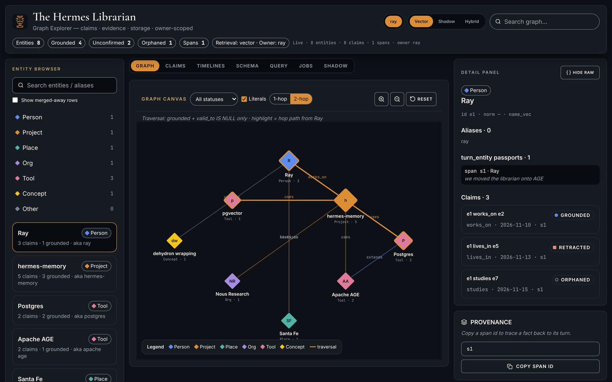
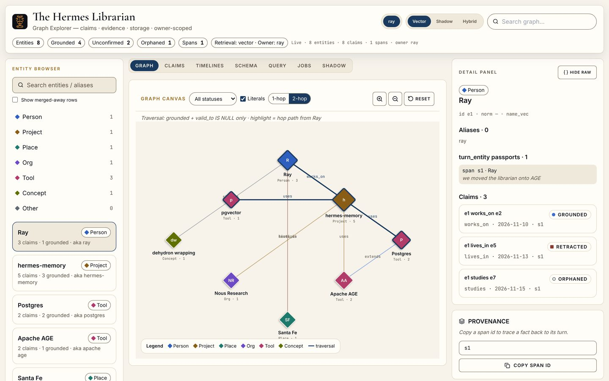

# Pane on the design system — 2026-11-24

**Change:** `ui/graph-explorer` now reads every colour, font and component class
from `docs/design-system` (`tokens.css`, `components.css`); the build in
`docs/graph/explorer/` is regenerated from that source.

**Evidence level reached: 5, not 6.** The built pane was served by the real
`hermes_memory.graph_http.Handler` (`ThreadingHTTPServer` on `127.0.0.1:7899`)
and loaded in headless Chromium in both colour schemes: `index.html` got the
injected `<base>`, the JS, CSS and PNG assets returned 200 with correct types,
there were no page errors and no 4xx responses. The `/explorer/owners` and
`/explorer/snapshot` responses were **stubbed fixtures** (no Postgres in the
session), so this does not show live data. A level-6 run needs a human
on the live `:7890` pane against the real `hermes_memory` DB.

| Ink (dark OS) | Parchment (light OS) |
| --- | --- |
|  |  |

**Before → after (same fixture):** in dark mode the old pane rendered the title,
claim-card titles and canvas label in near-invisible lapis or white on white. The
old palette set light-mode colours inline (`#fff`, `#16325C`, `#DCE8FA`).
All such inline hexes are gone from `App.tsx`. The one exception is the canvas drop-shadow.

**Checks:** `pytest tests/property` 207 passed (includes
`tests/property/test_design_tokens.py`); `tsc --noEmit` clean; `vite build` clean.
`tests/test_graph_api.py` has 2 failures that also fail on the untouched tree
(`test_search_builds_hypotheses_only_from_conversation_passports`,
`test_search_thresholds_before_expand_and_funnel`). They are pre-existing and unrelated.
`ui/graph-explorer/package-lock.json` is out of sync with `package.json`
(`npm ci` refuses). That is also pre-existing, and the lockfile is left untouched here.
